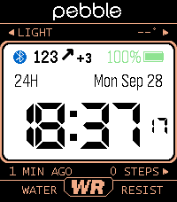
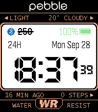
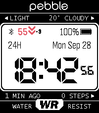
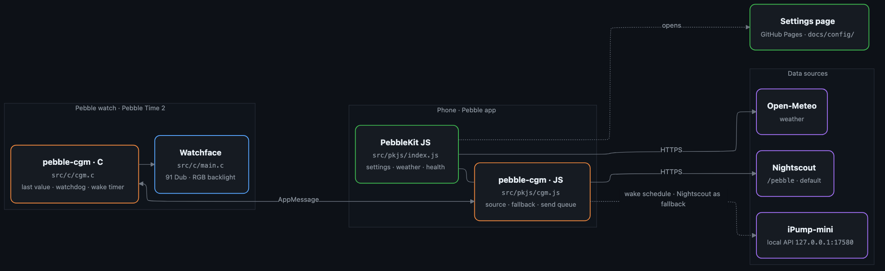

# 91 Dub CGM (dubv4cgm)

**English** · [Deutsch](README.de.md)

The classic **91 Dub** watchface for the **Pebble Time 2** – with a live **CGM** value from Nightscout or iPump-mini, weather, health data and the RGB backlight.

**Status:** in the Pebble Appstore · data from Nightscout or [iPump-mini](https://github.com/sgitaize/iPump-mini) · actively maintained

## Get it

| | |
|---|---|
| **Pebble Appstore** | [91 Dub CGM](https://apps.rePebble.com/49c4f560ff4141548025f29f) – install from the Pebble app on your phone |
| **Releases** | [`.pbw` on GitHub](https://github.com/sgitaize/dubv4cgm/releases/latest) for side-loading |
| **Settings** | gear icon in the Pebble app → [settings page](https://sgitaize.github.io/dubv4cgm/config/) (English / German) |

| In range | Stale reading | Low, theme "91 Dub v2.0" |
|---|---|---|
|  |  |  |

## Features

- **CGM** in the panel's top row: value, trend arrow, delta
  - **two data sources:** Nightscout (`/pebble`, default) or [iPump-mini](https://github.com/sgitaize/iPump-mini), the iPhone app that reads a MiniMed 780G directly – no internet needed; Nightscout can act as a fallback (small cloud)
  - high / low values in their own colours, stale values struck through, **OPEN APP** hint when iPump-mini isn't running
  - optional vibration on low / high (every 10 min at most)
  - optional: **backlight lights up in the high / low colour** (Pebble Time 2 RGB backlight)
  - mg/dL or mmol/L, sensor interval 5 min or 1 min
  - battery-friendly fetching right after each new reading, watchdog if the phone goes quiet; the last value survives a restart
- **Four edge labels** (LIGHT / PREV / NEXT / bottom left) can show: original label, CGM value, CGM age, weather, steps, heart rate, battery
- **Weather** from [Open-Meteo](https://open-meteo.com) (no API key), °C / °F
- **English / Deutsch** for all watch texts and the settings page
- Everything from 91 Dub v5 plus: steps / sleep, heart rate, 3 digital fonts, anti-aliasing, 2 colour sets (switch by time or tap), 200+ colour presets, custom backlight colour, power save, left-handed mode …

## Architecture

<p align="center"></p>

<sub>Source: <a href="docs/architecture.mmd">docs/architecture.mmd</a> (Mermaid)</sub>

**How it works**
- **The watch draws, the phone fetches.** The C code renders the face, complications and backlight colour; the JavaScript in the Pebble app (PebbleKit JS) talks to the internet and sends compact AppMessages.
- **pebble-cgm** handles everything CGM on both sides: choosing the source, timing fetches after each new reading, the iPump-mini wake schedule, fallback to Nightscout, a send queue with acknowledgements, and a watchdog on the watch. The same library runs in [CasioCGM](https://github.com/sgitaize/casiocgm) and [Nightscout-supercgm](https://github.com/sgitaize/Nightscout-supercgm).
- **Settings** are a static page on GitHub Pages: quick setup (language, colour preset, CGM source, complications) on top, everything else collapsible. The configuration travels in the URL fragment, so your Nightscout token never reaches a server.

| Part | Where | What it does |
|---|---|---|
| Watchface | `src/c/main.c`, `src/c/complications.c` | drawing, edge labels, CGM row, backlight colour |
| CGM (watch) | `src/c/cgm.c` | last value, status, watchdog, wake timer (from pebble-cgm) |
| Phone script | `src/pkjs/index.js` | settings, weather, messages to the watch |
| CGM (phone) | `src/pkjs/cgm.js` | Nightscout / iPump-mini, scheduling, fallback (from pebble-cgm) |
| Settings page | `docs/config/` | quick setup, 200+ presets, English / German |
| Store listing | `store/` | description, screenshots, `publish.sh` |
| Developer notes | [`AGENTS.md`](AGENTS.md) | message keys, settings, pitfalls |

## Configuration

**CGM:** choose Nightscout or iPump-mini. For Nightscout enter your site URL (e.g. `https://my-site.herokuapp.com`) and, if your site needs one, a token with read access – the watchface uses the `/pebble` endpoint. For iPump-mini you can enable Nightscout as a fallback.

## Building

```bash
npm install
pebble build          # after changing messageKeys: pebble clean first
pebble install --emulator emery
```

## Status & roadmap

- **Live:** 1.2.1 in the Pebble Appstore (Nightscout and iPump-mini, reliability fixes from pebble-cgm 1.1.0).
- Feedback is welcome via the [Pebble Appstore page](https://apps.rePebble.com/49c4f560ff4141548025f29f).

## Credits

A fork of [91 Dub v5 plus](https://codeberg.org/dflo/91-dub-v5-plus) by dflo (itself a fork of [91 Dub v5](https://codeberg.org/lightrush/91-dub-v5) by lightrush), based on the great [91 Dub v4.0](https://github.com/orviwan/91-dub-4.0) by Orviwan – thank you! Around 95 % of the CGM additions were built with [Claude Code](https://claude.com/claude-code).

## License

MIT-style, see [LICENSE](LICENSE). Fonts keep their own licenses.

This is a hobby project, **not a medical device**. Do not make treatment decisions based on this watchface.
